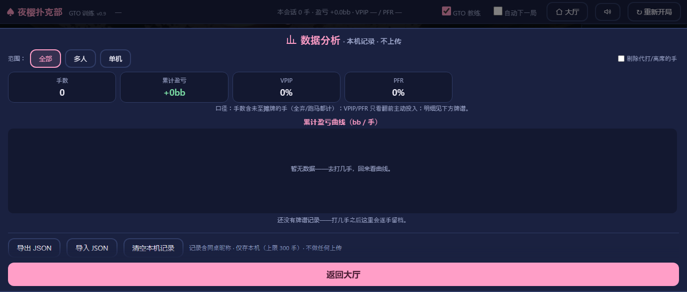

# 🌸 夜樱扑克部 · GTO 德州扑克训练器

一个**纯前端、零依赖**的无限注德州扑克游戏（NLHE 6-max / 4-max / 单挑），所有机器人内置 **GTO（博弈论最优）决策引擎**，另有实时 GTO 教练、PeerJS 好友房联机、看板娘养成系统，以及一套经双源交叉验证的中文 GTO 理论知识库。

[](LICENSE)
[](https://stre1itziaa.github.io/gto-poker/)


| 大厅 | 对局 · GTO 教练 | 数据分析 |
|---|---|---|
|  |  |  |

## 🎮 在线试玩 / 快速开始

**在线玩**：[https://stre1itziaa.github.io/gto-poker/](https://stre1itziaa.github.io/gto-poker/)

**本地玩**：

- 方式一（最简单）：直接双击 `index.html`（经典脚本加载，`file://` 可用）；
- 方式二（推荐，兼容性最好）：

```bash
npm start            # 或 node serve.js [端口]，默认 http://localhost:8787/
```

规则：盲注 10/20、100bb 深度（2000 筹码）、打光才补码（休闲模式）。

## 特性

- **GTO 机器人同桌**：不偷看你的牌，只根据公开动作维护对手范围模型，决策理由实时写进牌局日志；
- **GTO 教练面板**：轮到你时给出胜率条、底池赔率、MDF 与建议动作（Web Worker 线程计算，主线程零阻塞）；
- **好友房联机**：PeerJS P2P、房码制、房主权威架构——客人端从头到尾看不到别人底牌，空位由机器人补齐；
- **看板娘养成**：六位原创 AI 立绘部员，打牌涨好感度、解锁服装（图鉴收集）；
- **数据分析**：盈亏曲线、VPIP/PFR、对手倾向、牌谱逐手回看；
- **理论支撑**：`docs/theory/` 七篇中文 GTO 知识库，关键数字经公式推导与双源交叉验证。

## 机器人的 GTO 思想（`js/gto.js`）

机器人**从不偷看你的牌**。它们只根据公开动作历史为每个对手维护「范围模型」，然后：

1. **翻前图表**（`js/ranges.js`）：各位置 RFI（UTG 16% / HJ 21% / CO 29% / BTN 48% / SB 42%）、IP 线性 / OOP 线性+轮转 A 的 3bet、冷跟可玩性过滤、vs 3bet 的 4bet/跟注分层、≤11bb 纳什式 push/fold。
2. **范围胜率**（`js/equity.js`）：蒙特卡洛模拟「我的手牌 vs 对手建模范围」（1000-1800 次发牌），翻后每次决策实时计算。
3. **平衡下注**：下注频率看范围优势、下注尺度看坚果优势；c-bet 频率按牌面纹理（湿度抛物线）；河牌诈唬按价值：诈唬比（满池 2:1）配额。
4. **数学防守**：跟注先过底池赔率（需胜率 = b/(p+2b)），边缘牌按 MDF 保护范围，听牌加隐含赔率。
5. **阻断牌诈唬**：诈唬优先选持 A / 同花阻断的组合，河牌空气牌按预算诈唬。
6. **胜率实现（EQR）**：OOP 打折 0.85，听牌可玩性加分。
7. **混合策略**：边缘决策带随机频率，机器人之间不共谋、不针对你。

日志里每个机器人动作下的 `↳ …` 就是它的决策理由。

## GTO 教练面板（给你的）

轮到你行动时，右侧面板实时显示：

- 你的手牌 vs **每个机器人建模范围**的胜率条；
- 底池赔率（跟注需要多少胜率）与 MDF；
- 同一套引擎给出的 **GTO 建议动作 + 理由**。

先自己想，再看建议——这是最好的训练方式。

## 测试

```bash
node test/sim.js     # 回归：评估器/胜率/守恒/合法性/边池
node test/audit.js   # 行为审计：翻前弃牌率、c-bet 率、到街率 + 3bet-spam 剥削基准
```

**审计口径**（2026-09-15 外部评审后校正）：范围百分比一律用**组合空间**（某手牌之前的组合数 ÷ 1326），与求解器图表的百分比同口径——早期版本误用「类型序号 ÷ 169」导致所有范围实际收紧 30-50%（UTG 名义 16% 实际 11.3%），已修复并写入回归锚点。

改后基线（1500 手，6-max）：翻前结束 64%、见翻牌 36%、真实摊牌 12%、SB 面对加注弃 83%、BB 弃 69%、c-bet 65%、**面对下注加注 14.6%**（分档价值加注/check-raise 三条街全开）；「见加注就 3bet」的剥削脚本 **−50.1 ± 8.2 bb/100**（无脑激进会被机器人惩罚）。

**会话战绩**：顶栏显示「手数 / 盈亏 bb / VPIP·PFR / 重买次数」，盈亏只统计真实筹码转移（重买注入的筹码不计入）——重买是系统印钱，不能算进战绩。

## 文件结构

```
├── index.html            页面入口
├── serve.js              零依赖本地静态服务器（node serve.js）
├── css/                  牌桌/角色/大厅样式（含夜樱主题）
├── js/
│   ├── cards.js          牌 & 7 选 5 牌型评估器
│   ├── ranges.js         169 手牌排序（近似求解器 RFI 排序）+ 组合/范围工具
│   ├── equity.js         蒙特卡洛胜率引擎（vs 范围 / vs 手牌）+ 听牌侦测
│   ├── gto.js            GTO 决策引擎（机器人大脑 + 教练）
│   ├── engine.js         游戏引擎：盲注/下注轮/最小加注/全下/边池分层结算
│   ├── mp.js             好友房联机（PeerJS P2P · 房主权威 · 防偷看底牌）
│   ├── coach-worker.js   教练面板的 Web Worker
│   ├── portraits.js      立绘加载（t/s 双档 webp 懒加载回退链）
│   ├── affection.js      好感度系统
│   ├── anti-addiction.js TapTap 防沉迷封装（仅 APP 态生效，Web 态 no-op）
│   ├── ui.js / lobby.js / main.js / ...
├── assets/               牌面/筹码/桌面/立绘（立绘为原创 AI 生成）
├── docs/
│   ├── theory/           中文 GTO 知识库 01~07（理论依据）
│   ├── agent/            可移植 GTO 教练智能体系统提示词
│   ├── dev/              开发计划、测试报告、TapTap/防沉迷研究、截图
│   └── research/         角色人设调研
├── test/                 无头回归 + 行为审计脚本与报告
├── tools/                牌面/立绘生产管线（抠图/对齐/压缩/卡牌合成）
└── mobile/               Capacitor 安卓工程（可选，web 版无需）
```

## 知识库导航（docs/theory/）

| 文件 | 内容 | 适合什么时候读 |
|---|---|---|
| [01-fundamentals.md](docs/theory/01-fundamentals.md) | GTO 定义、纳什均衡、混合策略与无差别原理、GTO vs 剥削、常见误解、扑克 AI 里程碑 | 建立世界观，最先读 |
| [02-core-math.md](docs/theory/02-core-math.md) | 底池赔率、Alpha/MDF、河牌价值:诈唬比、几何尺寸、SPR、隐含赔率（全公式 + 速查表） | 随手查阅的数学手册 |
| [03-preflop.md](docs/theory/03-preflop.md) | 范围思维、各位置开局范围、3-bet/4-bet 结构、筹码深度与 MTT 调整 | 翻前决策参考 |
| [04-postflop-betting.md](docs/theory/04-postflop-betting.md) | 范围优势/坚果优势、牌面纹理、c-bet 频率、下注尺度理论、各街策略 | 翻后决策参考 |
| [05-bluff-blockers-eqr.md](docs/theory/05-bluff-blockers-eqr.md) | 诈唬候选牌选择、多街诈唬规划、阻断牌（blocker）、胜率实现（EQR） | 精进细节 |
| [06-solvers-training.md](docs/theory/06-solvers-training.md) | 求解器原理（CFR）、工具对比、学习方法论、书籍/课程/中文资源清单 | 想系统训练时 |
| [07-cheatsheet.md](docs/theory/07-cheatsheet.md) | 一页纸实战备忘录：所有公式表 + 决策检查清单 | 打牌时旁边放着 |

## 已知简化（诚实声明）

- 169 手牌的排序是「近似求解器」的人工排序，截断锚点对齐主流图表，但不等于任何具体求解器输出。
- 范围建模用「翻前图表 + 翻后激进度过滤」的启发式，不是完整的贝叶斯范围更新。
- 翻后策略是 GTO 原则（优势→频率/尺度、无差别、配额）的程序化，不是逐局面求解——真正的 NLHE 求解需要 CFR 数小时以上的算力。
- 机器人不会动态学习你的倾向（剥削性调整是固定的人群倾向规则）。
- **补码规则：打光才补**（并计数显示），不做不足 20bb 自动补码——避免筹码池通胀、让短码策略真实触发。
- 5 台机器人共用同一套无状态均衡策略，这是有意的（它们本该是同一个纳什均衡的化身）；外部审计已验证无针对玩家的暗桩。

## 操作

- 鼠标/触屏：弃牌 / 过牌·跟注 / 加注滑杆 + 预设（⅓池·½池·¾池·满池·全下）
- 键盘：`F` 弃牌 · `C`/空格 过牌·跟注 · `R` 按当前滑杆加注 · `↑↓` 调整加注额（`Shift+↑↓` 大步进）

## Android（可选）

`mobile/` 内含 Capacitor 安卓工程与 TapTap 防沉迷接入（见 `docs/dev/防沉迷SDK接入.md`）。构建：`python sync_www.py` → `npx cap sync` → `gradlew assembleDebug`。Web 版无需此目录。

## License

[MIT](LICENSE) · 立绘为原创 AI 生成，随项目同许可证分发。
